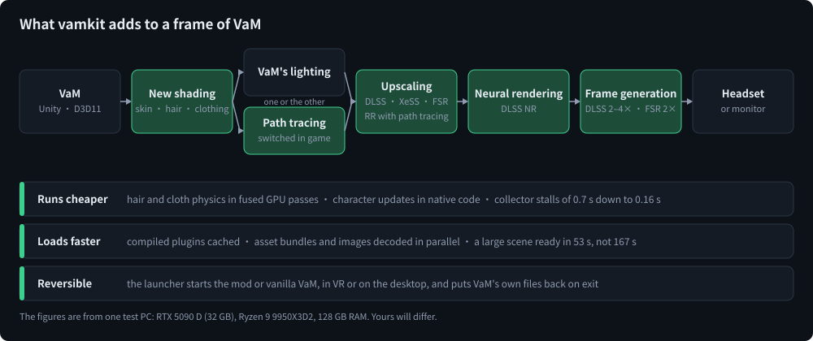
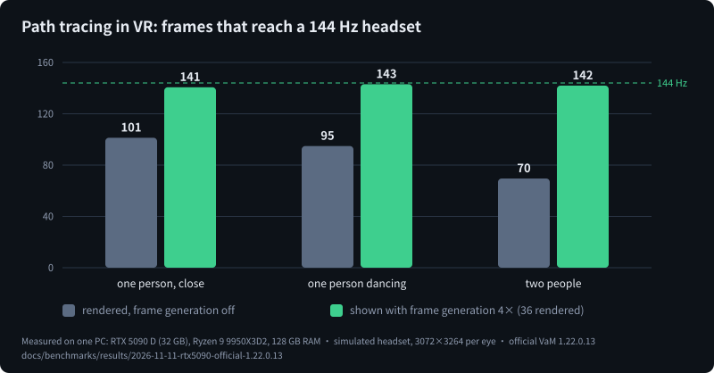
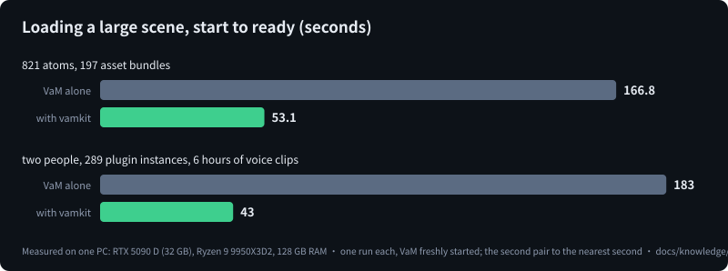
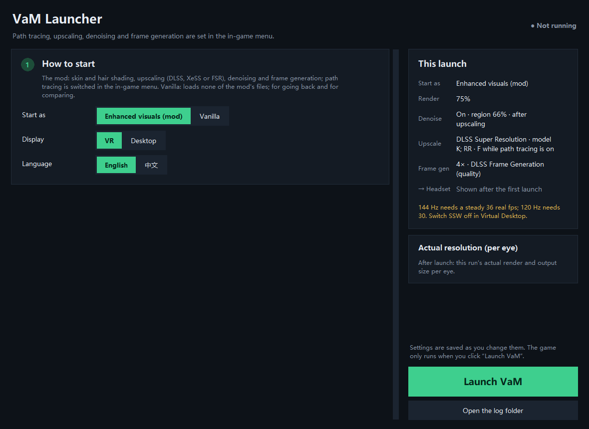

# vamkit

**Path tracing, modern upscaling and frame generation, new skin, hair and clothing shading, and much shorter loading
for Virt-A-Mate (VaM) 1.x, in VR and on the desktop.** It is source only: it is built on your own PC against your own
copy of VaM, and it is written to be installed, tuned and extended by a coding agent.

[中文说明](README.zh.md) · [For your agent: AGENTS.md](AGENTS.md) · [Measurements](docs/benchmarks/README.md) · [Changes](CHANGELOG.md)

## How to use it

> [!IMPORTANT]
> **Try it on a separate, clean copy of VaM first, not on the installation you play in.** While it runs, this project
> replaces files of VaM and adds plugins that change how scenes load, render and simulate, and it has been run on one
> PC only. Put a fresh copy of VaM in a folder of its own, with its own BepInEx and only the content you want to test,
> install into that, and move to your main installation only after it has proved itself on your machine. The install
> is reversible, but your scenes, saves and plugins are yours to protect: back up what you cannot replace.

### Recommended: give it to the agent you trust most

This project changes how VaM renders at several levels: a D3D11-on-12 device, the VR compositor, an OpenXR layer,
shaders generated from your own VaM's shaders, and sixteen plugins. Machines differ a lot in exactly those
places: the card's vendor and generation, the driver, the headset and its runtime, the VaM build, the BepInEx
version. Getting it right on your machine is a job of reading logs, measuring and adjusting, and that is what a coding
agent is good at. The repository is written for it: [AGENTS.md](AGENTS.md) is the entry, the guides say how each part
works and how to find the cause of a problem, and the test tools the project was built with are included.

Open the agent you trust most (Claude Code, Codex, Cursor or another one) on your PC and tell it something like:

> Clone the vamkit repository, read AGENTS.md, and install it into the clean copy of VaM I keep for testing at
> `D:\VaM-test` (not the one I play in). Show me the plan before you change anything in that folder. Run the first-run check, then tune it for my graphics card and my headset, and tell
> me what I get less of on this machine and why.

It will ask you for a few things only you can give: where your VaM is, your agreement to the vendors' licence terms
(their run-time files are downloaded from them, not from here), your go-ahead for the install plan, and what you see
in the headset.

### By hand

```
python tools/vamkit doctor --vam "D:/VaM-test" # a clean copy of VaM; what is there, what is missing; changes nothing
python tools/vamkit fetch --accept-licenses    # third-party parts, from their vendors
python tools/vamkit bepinex --yes              # puts BepInEx 5 into the VaM folder when it has none
python tools/vamkit build
python tools/vamkit test
python tools/vamkit install                    # prints the plan; --yes does it
```

[docs/agent/install.md](docs/agent/install.md) goes through each step.

### Day to day

- Double-click `vamkit-launcher.bat` in your VaM folder, choose the mod or vanilla, VR or desktop, and launch.
- In game, open VaM's main menu: the **VR Graphics** tab (**Graphics** on the desktop) has path tracing, the upscaler,
  the denoiser, frame generation and the skin settings; **Hair Budget** and **Display Lighting** have their own tabs.
- Vanilla is always one click away, and `python tools/vamkit uninstall` leaves the VaM folder as it was.

## What it needs

- Your own licensed copy of VaM 1.x. It needs BepInEx 5 (the plugin loader): `vamkit bepinex` installs it when the folder has none
- Windows 10 or 11 and a current graphics driver. Path tracing and DLSS need an NVIDIA RTX card (path tracing needs
  DXR 1.1)
- To build: Visual Studio 2022 Build Tools (C++ and a Windows SDK), CMake, Git, Python 3.11 or later, and the Windows
  feature ".NET Framework 3.5"
- For VR: a headset reached through an OpenXR runtime

## What you get



### A better picture

- **Path tracing, switched on and off in game.** People, clothing, rooms and hair are path traced and reconstructed
  with DLSS Ray Reconstruction. It reads the scene author's lights, shadows, ambient light and reflection probes the
  way Unity means them.
- **With path tracing off**, VaM's own lighting gets new skin shading (subsurface scattering, light through ears and
  fingers, eyes and teeth), strand hair shading and clothing shading.
- Tone mapping, and an optional set of studio lighting styles you can put on any scene.

### Smooth motion at a high resolution

- **Upscaling**: DLSS Super Resolution, Intel XeSS or AMD FSR, each with its own render scale, changed in game.
- **Denoising**: the DLSS neural denoiser on the output.
- **Frame generation** in VR and on the desktop: DLSS Frame Generation 2x to 4x, or FSR's 2x on cards without it.



With path tracing on, the test PC renders 70 to 101 frames a second for a headset of 3072x3264 per eye. With frame
generation it renders 36 at an even pace and the headset is handed 141 to 143 new frames a second.

The new picture costs frames; frame generation is what fills the display. The same PC on a 4K monitor, real frames
per second without frame generation:

| Scene | VaM alone | vamkit, VaM's lighting | vamkit, path traced |
|---|---|---|---|
| one person, close | 282 | 207 | 171 |
| one person dancing | 264 | 189 | 156 |
| two people | 122 | 81 | 94 |

Scenes with three people and soft body physics are held back by VaM's own physics on the CPU, with or without the kit
([the full results](docs/benchmarks/README.md) say where each limit is).

### Less waiting, fewer stalls



- **Loading**: scene plugins are compiled once and cached, asset bundles and images are read and decoded in parallel,
  repeated work in VaM's own load path is skipped. Results are VaM's own.
- **Stalls**: a heavy scene pauses for most of a second every few minutes while Mono collects garbage. The pause is
  about 0.16 s here in place of 0.7 s, and it comes less often.
- **Hair, clothing and character updates** cost less time per frame (hair and cloth physics in fused GPU passes,
  character hot paths in native code), with the same results as VaM's own code.

### A launcher and menus in your language



The launch panel starts the **mod** or **vanilla** VaM, in **VR** or on the **desktop**. Vanilla loads nothing of this
project. In game the settings are a tab in VaM's main menu. Both are in English and Chinese; another language is one
table of texts ([components/shared/lang](components/shared/lang/README.md)).

## The test machine

**Status: work in progress.** The repository fetches its third-party parts, builds every component from source, runs
its offline tests and installs into a VaM folder reversibly. Its first run has passed on an official VaM 1.22.0.13 with
the current BepInEx 5, on the desktop and in VR on a simulated headset. This repository's build has not been tried in a
real headset, on a card that is not NVIDIA's, or with large real scenes yet.

Every number and picture on this page comes from one PC. Read them as what this build does on that PC, not as what
it will do on yours.

| | |
|---|---|
| Graphics card | NVIDIA GeForce RTX 5090 D, 32 GB, driver 616.56 |
| Processor | AMD Ryzen 9 9950X3D2, 16 cores / 32 threads |
| Memory | 128 GB |
| System | Windows 11 Pro |
| Monitor | 3840x2160 at 160 Hz |
| Headset in the measurements | a simulated one, 3072x3264 per eye at 144 Hz ([tools/lab](tools/lab/README.md)) |
| Headset used while developing | Quest 3 through Virtual Desktop |

Every version it has of what the kit depends on, and what to do where yours differ, is in
[docs/agent/reference-machine.md](docs/agent/reference-machine.md); `python tools/vamkit versions` compares your machine
with it. Nothing else has been tried: no RTX 40 or 30 card, no AMD or Intel card, no other headset. A smaller card gets less,
path tracing most of all; the render scales, the path tracer's bounces and its background savings are there to be
set for it, and XeSS, FSR and FSR frame generation are there for cards without DLSS. What a part does when the
machine cannot run it is said in the launcher and in the logs, not hidden.

## At a glance

| Part | What you get |
|---|---|
| Path tracing (in-game switch) | People, clothing, rooms and hair path traced, reconstructed by DLSS Ray Reconstruction |
| Path tracing off | VaM's own lighting and shadows with the new skin, hair and clothing shading |
| Upscaling | DLSS SR models K / L / M (path tracing off) or RR (path tracing on), each with its own render scale; Intel XeSS and AMD FSR as further choices with path tracing off, also on cards without DLSS (run on an RTX card only so far) |
| Denoising | DLSS neural denoiser on the output, adjustable in game |
| Frame generation | DLSS Frame Generation 2-4x, in VR through the OFXR layer and on the desktop through our own presenter; AMD FSR frame generation (2x) where DLSS Frame Generation cannot run |
| Skin | Screen-space subsurface scattering and light through thin parts (ears, fingers), with or without path tracing |
| Runtime | Hair and cloth physics in fused GPU passes, clothing wraps batched, character CPU hot paths in native code, a faster Mono collector, a hair cost budget. Same results as VaM's own code |
| Loading | Plugin compile cache, asset bundles from memory, parallel audio and image decoding, scene switches that keep what the next scene needs |
| Launcher and menus | The mod or vanilla, VR or desktop; English and Chinese. Vanilla loads nothing of this project (and no BepInEx plugin at all) |

## Written for your agent

The repository is a base to build on, not a fixed feature list: with the sources, the measurements, the guides and
the tools here, your agent is expected to get you whatever can be got on your machine, including what this project has
not implemented. Nothing in the documents is meant as a limit.

- [AGENTS.md](AGENTS.md): where to start, the rules, the commands.
- [docs/agent](docs/agent): how to install, change a component, adapt to another VaM build, and find the cause of a
  problem.
- [docs/knowledge](docs/knowledge): how every part works and why it is built that way, what was measured, what was
  tried and dropped, what is still open.
- [docs/protocol](docs/protocol): how we test, judge performance and change an installation without breaking it.
- [docs/benchmarks](docs/benchmarks/README.md): the standard scenes, the method and the published results.
- [tools/lab](tools/lab): the test and measurement tools we use ourselves.
- Every component folder has a README with its files, build, settings, tests and what a change must not break.

## Important

- Unofficial. Not affiliated with or endorsed by MeshedVR, NVIDIA, Intel or AMD.
- While the mod runs, the launcher replaces VaM's `VaM_Data/Plugins/openvr_api.dll` with OpenComposite and puts a
  `d3d11.dll` beside `VaM.exe`; it puts VaM's own files back when VaM exits. `launch.py --restore` does that by hand.
- The vendors' run-time files and SDKs are not in this repository. `vamkit fetch` downloads them from the vendors
  after you accept their terms.
- Some shaders are generated at build time from the shaders inside your VaM installation; they never leave your PC.

## License

Our code is MIT. OpenComposite is GPL-3.0 and OFXR Bridge is LGPL-3.0, as upstream. See [THIRD_PARTY.md](THIRD_PARTY.md).
