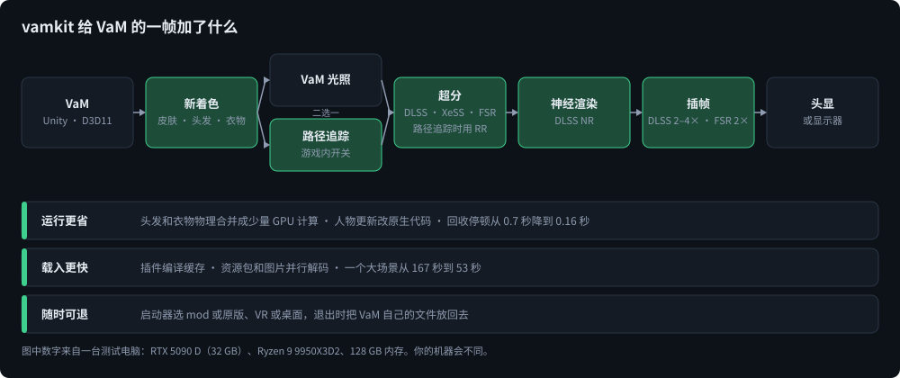
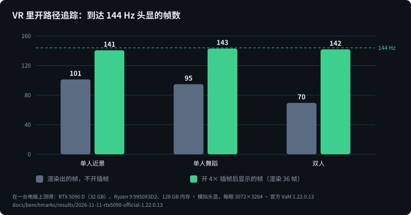
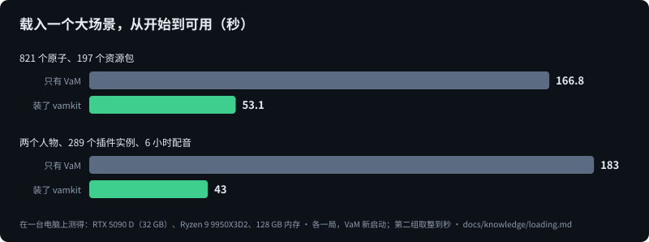
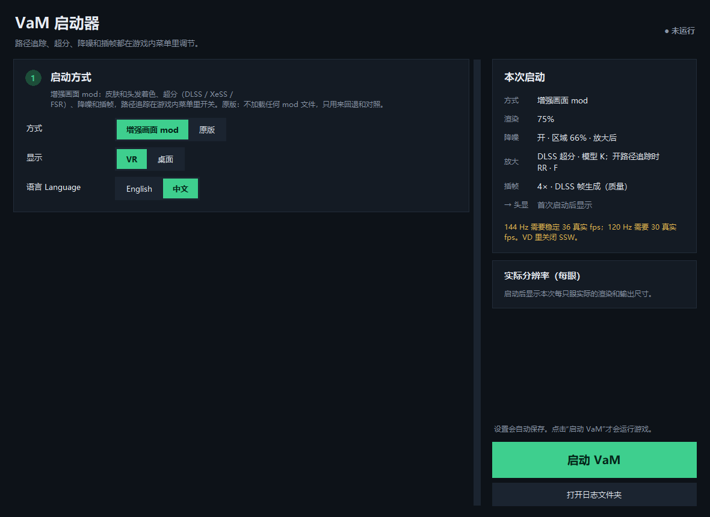

# vamkit

**给 Virt-A-Mate（VaM）1.x 的路径追踪、新一代超分和插帧，新的皮肤、头发、衣物着色，以及短得多的载入时间，VR 和桌面都能用。**
只发源码：在你自己的电脑上、对着你自己的 VaM 构建；整个仓库是按“交给编程 agent 来安装、调试、扩展”写的。

[English](README.md) · [给 agent 看的：AGENTS.zh.md](AGENTS.zh.md) · [实测数据](docs/benchmarks/README.md) · [更新记录](CHANGELOG.md)

## 怎么用

> [!IMPORTANT]
> **请先在一份独立、纯净的 VaM 上试用，不要直接装进你平时玩的那份。** 本项目运行时会替换 VaM 的文件，并加入会改变场景载入、
> 渲染和物理的插件，而且目前只在一台电脑上跑过。请另开一个文件夹放一份全新的 VaM，单独装 BepInEx，只拷入想测试的内容，
> 装到那里面；在你的机器上确认没问题之后，再考虑装进主力安装。安装是可逆的，但场景、存档和插件要靠你自己保护：
> 无法重来的东西请先备份。

### 推荐：交给你最信赖的 agent

这个项目在好几层上改了 VaM 的渲染：D3D11-on-12 设备、VR 合成器、OpenXR 层、从你自己 VaM 的着色器生成的着色器，外加十六个
插件。而不同电脑恰恰在这些地方差别很大：显卡的厂商和代际、驱动、头显和它的运行时、VaM 的版本、BepInEx 的版本。要在你的机器
上落地调好，是一件读日志、量数据、反复调整的活，正是编程 agent 擅长的。仓库就是为它写的：[AGENTS.zh.md](AGENTS.zh.md) 是入口，
各份指南讲清每个部分怎么工作、出了问题怎么找原因，项目自己用的测试工具也都在里面。

在你的电脑上打开你最信赖的 agent（Claude Code、Codex、Cursor 或别的），对它说类似这样的话：

> 把 vamkit 仓库克隆下来，读 AGENTS.zh.md，然后装进我专门用来测试的那份纯净 VaM（在 `D:\VaM-test`，不是我平时玩的那份）。
> 动那个文件夹之前先把计划给我看。跑首次运行检查，
> 再按我的显卡和头显调好，最后告诉我在这台机器上哪些功能打了折扣、为什么。

它只会向你要几样只有你能给的东西：VaM 在哪、你是否同意各厂商的许可条款（它们的运行库从厂商那里下载，不在本仓库里）、
你对安装计划的确认，以及你在头显里看到了什么。

### 自己动手

```
python tools/vamkit doctor --vam "D:/VaM-test" # 指向那份纯净 VaM；看现状、缺什么，不改任何东西
python tools/vamkit fetch --accept-licenses    # 第三方依赖，从各厂商下载
python tools/vamkit build
python tools/vamkit test
python tools/vamkit install                    # 先打印计划；加 --yes 才执行
```

每一步的说明在 [docs/agent/install.md](docs/agent/install.md)。

### 平时怎么玩

- 双击 VaM 文件夹里的 `vamkit-launcher.bat`，选 mod 或原版、VR 或桌面，点启动。
- 游戏里打开 VaM 主菜单：**VR 画面**页（桌面是**画面**）里有路径追踪、超分、降噪、插帧和皮肤设置；**头发预算**和**展示照明**
  各有自己的页。
- 原版永远只隔一次点击；`python tools/vamkit uninstall` 把 VaM 文件夹恢复成安装前的样子。

## 需要什么

- 你自己的正版 VaM 1.x，里面装好 BepInEx 5
- Windows 10 或 11，较新的显卡驱动。路径追踪和 DLSS 需要 NVIDIA RTX 显卡（路径追踪需要 DXR 1.1）
- 构建要用：Visual Studio 2022 Build Tools（C++ 和 Windows SDK）、CMake、Git、Python 3.11 或更新，以及 Windows 功能
  “.NET Framework 3.5”
- VR：一台能通过 OpenXR 运行时连上的头显

## 有什么，能提高什么



### 画面更好

- **路径追踪，游戏里随时开关。** 人物、衣物、房间、头发全部路径追踪，由 DLSS RR（光线重建）重建；场景作者的灯光、阴影、
  环境光和反射探针按 Unity 的本意去读。
- **不开路径追踪时**，VaM 自己的光照配上新的皮肤着色（次表面散射、耳朵和手指的透光、眼睛和牙齿）、发丝着色和衣物着色。
- 色调映射；还有一组可选的“展示照明”布光风格，任何场景都能套用。

### 高分辨率下也流畅

- **超分**：DLSS 超分、Intel XeSS 或 AMD FSR，各有自己的渲染比例，游戏里切换。
- **降噪**：输出上的 DLSS 神经降噪。
- **插帧**，VR 和桌面都有：DLSS 插帧 2×–4×；没有它的显卡用 FSR 的 2×。



开着路径追踪，测试电脑给每眼 3072×3264 的头显每秒渲染 70–101 帧；开插帧后稳定渲染 36 帧，头显每秒拿到 141–143 帧新画面。

新画面是要花帧数的，把显示器填满的是插帧。同一台电脑接 4K 显示器、不开插帧时的真实帧率：

| 场景 | 只有 VaM | vamkit，VaM 光照 | vamkit，路径追踪 |
|---|---|---|---|
| 单人近景 | 282 | 207 | 171 |
| 单人舞蹈 | 264 | 189 | 156 |
| 双人 | 122 | 81 | 94 |

三个人物再开软体物理的场景，卡在 VaM 自己的 CPU 物理上，装不装都一样（每个场景卡在哪里，见[完整结果](docs/benchmarks/README.md)）。

### 少等待、少顿卡



- **载入**：场景插件只编译一次并缓存，资源包和图片并行读取、解码，VaM 载入流程里重复的工作跳过；结果和 VaM 自己的一样。
- **顿卡**：重场景每隔几分钟会因为 Mono 回收内存停大半秒。这里每次约 0.16 秒（原来约 0.7 秒），间隔也更长。
- **头发、衣物、人物的每帧更新**更省时间（头发和衣物物理合并成少量 GPU 计算，人物的 CPU 热点改成原生代码），结果和 VaM
  自己的代码相同。

### 启动器和菜单有中英文



启动器选 **增强画面 mod** 或 **原版**、**VR** 或 **桌面**。原版不加载本项目的任何东西。游戏里的设置是 VaM 主菜单里的一页。
两者都有中文和英文；再加一种语言只要一张文字表（[components/shared/lang](components/shared/lang/README.md)）。

## 测试用的电脑

**状态：开发中。** 仓库已经能自己取第三方依赖、从源码构建全部组件、跑离线测试，并且可逆地装进 VaM 目录；在官方 VaM 1.22.0.13
加当前的 BepInEx 5 上通过了首次运行检查（桌面模式，以及模拟头显上的 VR）。这份构建还没有在真头显里、非 NVIDIA 显卡上、
大型真实场景里试过。

本页所有数字和图片都来自同一台电脑。请把它们读成“这份构建在这台电脑上的表现”，不是你的电脑上会有的表现。

| | |
|---|---|
| 显卡 | NVIDIA GeForce RTX 5090 D，32 GB，驱动 616.56 |
| 处理器 | AMD Ryzen 9 9950X3D2，16 核 / 32 线程 |
| 内存 | 128 GB |
| 系统 | Windows 11 专业版 |
| 显示器 | 3840×2160，160 Hz |
| 测量用的头显 | 模拟头显，每眼 3072×3264，144 Hz（[tools/lab](tools/lab/README.md)） |
| 开发时用的头显 | Quest 3，经 Virtual Desktop |

别的硬件都没试过：没有 RTX 40 / 30，没有 AMD 或 Intel 显卡，没有别的头显。显卡小一些，得到的就少一些，路径追踪差得最多；
渲染比例、路径追踪的反弹次数和背景减负就是给这种情况调的，XeSS、FSR 和 FSR 插帧是给没有 DLSS 的显卡准备的。某个部分在
你的机器上跑不了时，启动器和日志会明说，不会悄悄降级。

## 一览

| 部分 | 效果 |
|---|---|
| 路径追踪（游戏内开关） | 人物、衣物、房间、头发全部路径追踪，由 DLSS RR 重建 |
| 路径追踪关 | VaM 自己的光照和阴影，加上新的皮肤、头发、衣物着色 |
| 超分 | 路径追踪关时 DLSS SR 的 K / L / M，开时 RR，每个模型各有自己的渲染比例；路径追踪关时还可以选 Intel XeSS 和 AMD FSR，没有 DLSS 的显卡也能用（目前只在 RTX 显卡上跑过） |
| 降噪 | 输出上的 DLSS 神经降噪，游戏内可调 |
| 插帧 | DLSS 插帧 2–4×，VR 走 OFXR 层，桌面走我们自己的呈现器；DLSS 插帧跑不了的地方用 AMD FSR 插帧（2×） |
| 皮肤 | 屏幕空间次表面散射和薄处透光（耳朵、手指），开不开路径追踪都有 |
| 运行优化 | 头发和衣物物理合并成少量 GPU 计算、包裹衣物合批、人物的 CPU 热点改原生、更快的 Mono 回收器、头发开销预算；结果和 VaM 自己的代码相同 |
| 载入 | 插件编译缓存、资源包走内存、音频和图片并行解码、换场景时留下下一个场景要用的东西 |
| 启动器和菜单 | mod 或原版、VR 或桌面；中文和英文。原版不加载本项目的任何东西（也不加载任何 BepInEx 插件） |

## 为你的 agent 写的

这个仓库是一块地基，不是一份写死的功能清单：凭这里的源码、实测、指南和工具，你的 agent 应该把你这台机器上能做到的都做到，
包括本项目还没实现的。文档里没有哪一句是用来设限的。

- [AGENTS.zh.md](AGENTS.zh.md)（英文完整版 [AGENTS.md](AGENTS.md)）：从哪里开始、规则、命令。
- [docs/agent](docs/agent)：怎么安装、怎么改一个组件、怎么适配别的 VaM 版本、怎么找问题的原因。
- [docs/knowledge](docs/knowledge)：每个部分怎么工作、为什么这样做、实测了什么、哪些试过放弃了、哪些还没解决。
- [docs/protocol](docs/protocol)：我们怎么测试、怎么判断性能、怎么改一个安装而不弄坏它。
- [docs/benchmarks](docs/benchmarks/README.md)：标准场景、测法和已发布的结果。
- [tools/lab](tools/lab)：我们自己用的测试和测量工具。
- 每个组件目录都有 README：文件、构建、设置、测试，以及改动时不能破坏什么。

指南、知识文档和代码注释是英文的（agent 读起来没有障碍）；给人看的说明和菜单有中文。

## 重要说明

- 非官方项目，与 MeshedVR、NVIDIA、Intel、AMD 无关，也未获其认可。
- mod 运行期间，启动器会把 VaM 的 `VaM_Data/Plugins/openvr_api.dll` 换成 OpenComposite，并在 `VaM.exe` 旁放一个
  `d3d11.dll`；VaM 退出时把原文件放回去。`launch.py --restore` 可以手动恢复。
- 各厂商的运行库和 SDK 不在本仓库里；`vamkit fetch` 在你同意它们的条款后从厂商那里下载。
- 一部分着色器在构建时从你的 VaM 安装里的着色器生成，只留在你的电脑上。

## 许可

我们自己的代码是 MIT。OpenComposite 是 GPL-3.0，OFXR Bridge 是 LGPL-3.0，与上游一致。见 [THIRD_PARTY.md](THIRD_PARTY.md)。
